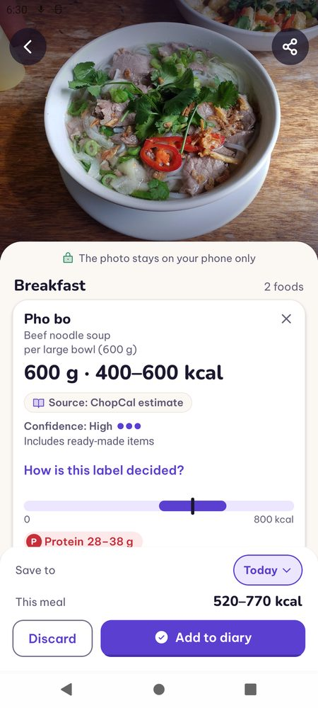
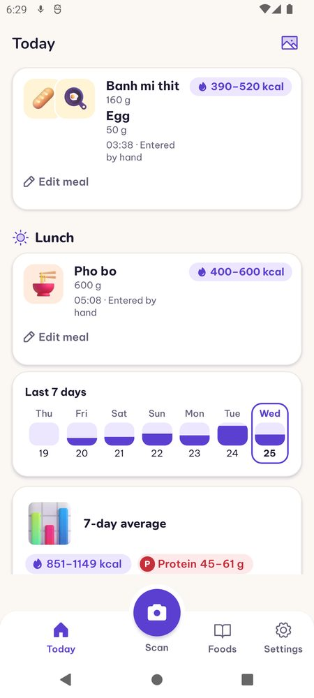
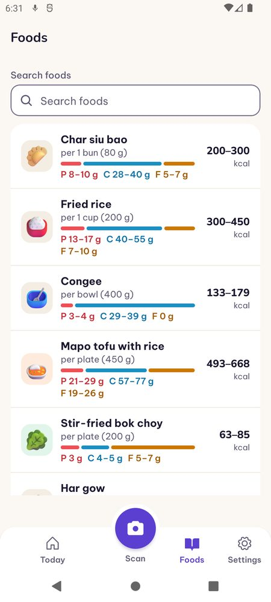
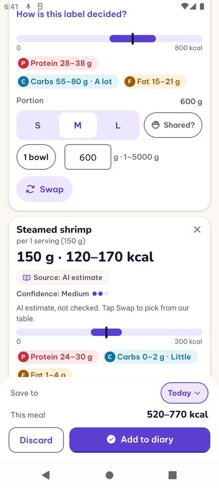

# ChopCal

**Snap your meal, see the calories in every dish.** Calorie, protein, carb and fat ranges, strong on Vietnamese and Asian food.

<p align="center"></p>

## What you can do

| | |
|---|---|
| Scan a meal | One photo, a range for each dish |
| Fix it | Swap a dish, change the portion, then save |
| Food diary | Today and the last 7 days |
| Foods | Search the food table |
| Ask your AI | Use ChopCal from ChatGPT or Claude |

<p>



</p>

## Free and Plus

| | Free | Plus |
|---|---|---|
| Scans | 3 a day | Up to 60 a day |

Details: [chopcal.com](https://chopcal.com/?utm_source=github-chopcal&utm_medium=readme-plans)

## Install

**Android:** [Google Play](https://play.google.com/store/apps/details?id=com.vuduykien.chopcal&referrer=utm_source%3Dgithub-chopcal%26utm_medium%3Dreadme) · iPhone: coming soon

**ChatGPT / Claude:** [how to connect](https://chopcal.com/mcp-server?utm_source=github-chopcal&utm_medium=readme-connector)

Claude Code:

```
/plugin marketplace add vuduykien-netizen/chopcal
/plugin install chopcal@chopcal
```

Files for the connector are in [`connector/`](connector/).

## Calculator

BMI and daily calories in TypeScript, MIT: [`calc/`](calc/).

## Privacy

The photo is used to recognise your dishes and is not kept on our servers. Details: [Privacy](https://chopcal.com/privacy?utm_source=github-chopcal&utm_medium=readme-privacy).

Estimate only. Not medical advice. For adults.

## License

All rights reserved, except `calc/` (MIT). See [LICENSE](LICENSE) and [TRADEMARK.md](TRADEMARK.md).

---

⭐ Star this repo to help others find ChopCal.
